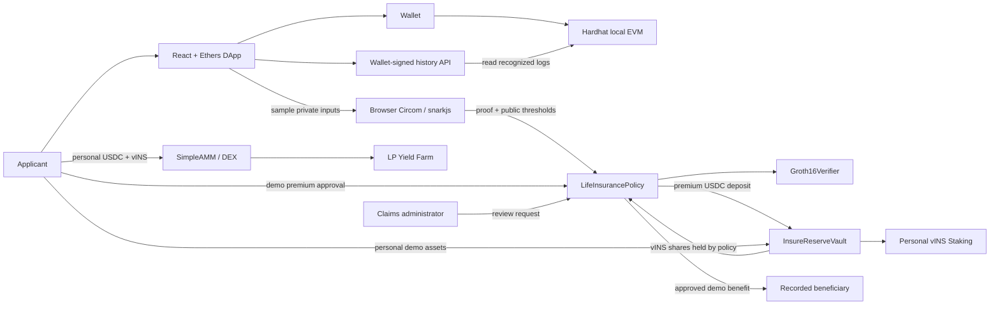

# InsureChain architecture

## Product intent

InsureChain is a student life-insurance DApp with an end-to-end, on-chain demonstration lifecycle. Privacy-preserving eligibility connects to a premium-funded policy; the premium becomes shares in a shared ERC-4626 reserve; a separate deployment account reviews demo benefits paid from policy-owned reserve shares. DeFi pages let users explore personal demo assets and shares that use the same token and vault system.

This is a prototype, not a real insurer. The application has no trusted underwriting input, identity service, real claims evidence verification, or financial value.

## System map

## Insurance lifecycle

1. The applicant sets sample income, credit score, risk, benefit, premium, and beneficiary. The beneficiary defaults to the applicant.
2. The browser generates the Groth16 proof. The form's private witness is not sent to the backend or included in policy storage. Public thresholds, premium, coverage, and beneficiary are on-chain.
3. `LifeInsurancePolicy` creates a `Pending` application. A valid proof moves it to `Verified`.
4. The applicant approves the premium token for the policy contract. `purchasePolicy` takes the premium, deposits it into `InsureReserveVault`, holds the minted vINS shares, sets a one-year expiry, and moves the policy to `Active`.
5. The policyholder can submit one unresolved demo benefit request up to the policy coverage while the policy is active. Only a reference hash is stored. The policy moves to `ClaimPending`.
6. `claimsAdmin` is the deployment account. It cannot review a claim on its own policy. Approval checks that policy-owned reserve shares can cover the amount, withdraws the amount from the vault, pays the recorded beneficiary, and sets `ClaimPaid`. Declining returns an unexpired policy to `Active`.
7. `policyStatus` reports `Expired` after the term even if the stored policy status has not been changed by a transaction.

The deployment seeds 100,000 demo USDC into the vault with the resulting shares owned by the policy contract. This reserve seed lets the claim path be shown before premiums accumulate. It is demo capital, not actuarial backing.

### Status values

| Value | State | Meaning |
|---:|---|---|
| 0 | None | Unused policy identifier |
| 1 | Pending | Application created; proof not verified |
| 2 | Verified | Proof valid; premium is due |
| 3 | Active | Premium deposited; policy term in force |
| 4 | ClaimPending | A benefit request awaits admin review |
| 5 | ClaimPaid | Benefit paid to the recorded beneficiary |
| 6 | Expired | The one-year term has ended |
| 7 | Rejected | Reserved for rejected policy state |

## DeFi connection

- `InsureReserveVault` is shared: applicant premiums are deposited by the policy contract and corresponding vINS shares are held by that contract; personal deposits mint shares to the user's wallet.
- The `SimpleAMM`, DEX, farm, and direct staking use personal demo balances. Their contracts cannot transfer policy-owned vINS shares, so those actions do not alter insurance reserve backing.
- The deployment seeds funded RWD schedules for farm and staking. Rewards are not policy benefits, premium discounts, or guaranteed investment returns.

## Other services and data

| Component | Responsibility |
|---|---|
| React/Vite | Application flow, wallet UI, proof generation, contract reads and writes |
| Ethers v6 | EIP-1193 wallet integration and ABI calls |
| Hardhat | Local EVM, compilation, deployment, deterministic demo contracts |
| Circom/snarkjs | Eligibility circuit and in-browser Groth16 proving |
| History backend | Verify a signed wallet challenge; index recognized public contract events for that wallet |
| `public/deployments/<chainId>.json` | Addresses, deployer/claims-admin, deployment block |

The history backend does not receive the raw eligibility witness or claim-reference text. It indexes public logs, not every transaction on the chain. Browser session history access is held in memory and cleared on wallet/account/network changes.

## Limitations

The circuit checks values typed into a demo form; it does not authenticate identity or the source and accuracy of underwriting data. A claim reference hash is not evidence validation, and the deployment account is a centralized demo reviewer. The reserve, contracts, DeFi pages, and test assets are educational, unaudited, and unsuitable for real financial or insurance use. Never enter real medical, identity, or financial information.
