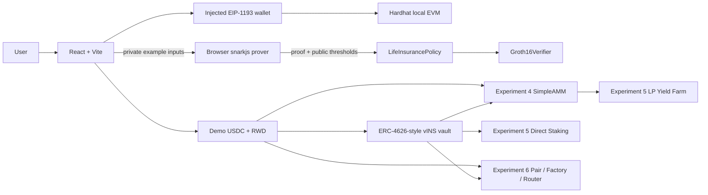

# InsureChain project design sheet

## Goal and actors

InsureChain demonstrates two related subjects: privacy-preserving life-insurance eligibility and DeFi contract mechanics. The user connects an EVM wallet. A local Hardhat deployer seeds the demo reward schedules. No insurer, bank, oracle, or external identity provider is integrated.

## System layout

## Experiment mapping

| Reference experiment | Project feature | Main contracts/UI |
|---|---|---|
| 1: React/Ethers DApp | Wallet DApp structure | `src/App.jsx`, Ethers v6 |
| 2: WalletConnect and MetaMask | Wallet selection | `src/App.jsx` supports injected EIP-1193 providers and WalletConnect QR/mobile sessions |
| Design sheet | Actors, data, architecture | This document |
| 3: ERC-4626 | Reserve demo vault | `DemoToken`, `InsureReserveVault` |
| 4: LP and AMM | Simple pool milestone | `SimpleAMM` |
| 5: Yield farming | LP reward stream | `SimpleYieldFarm` |
| 5: Staking | Direct vINS reward stream | `SimpleStaking` |
| 6: DEX | Factory-created pair and router | `InsureDexPair`, `InsureDexFactory`, `InsureDexRouter` |

## Insurance data flow

The form contains private example values (income, credit score, medical risk) and public thresholds. `generateEligibilityProof` runs Groth16 proving in the browser. The public signals are ordered as `[eligible, minIncome, minCreditScore, maxMedicalRisk]`. The frontend creates a policy record and submits the proof. `LifeInsurancePolicy` checks holder, pending status, eligibility, and exact threshold matches before calling the generated verifier. A valid proof activates the record.

The circuit does not authenticate the origin or accuracy of entered values. Real underwriting requires an appropriately trusted data source and reviewed circuit logic. The application must not collect real sensitive data for this demo.

## DeFi data flow

- `DemoToken` is a faucet-style ERC-20-like token used for demo USDC and RWD.
- `InsureReserveVault` takes demo USDC and mints vINS shares. It holds the underlying without a strategy or return guarantee.
- `SimpleAMM` is the Experiment 4 pool and exposes LP shares for users and the yield farm.
- `SimpleYieldFarm` stakes SimpleAMM LP shares. `SimpleStaking` separately stakes vINS.
- The Experiment 6 factory creates one pair per token pair. The pair stores reserves, LP ownership, swap invariant, and a 0.30% fee. The router handles liquidity and swaps with deadline/minimum-output checks.

Reward schedules are funded at deployment from the local RWD supply. Rewards are not guaranteed beyond funded contract balances. These demo contracts are educational and are not audited or suitable for real assets.

## On-chain and off-chain boundary

| Data | Location |
|---|---|
| Proof inputs | Browser form / browser prover only |
| Eligibility thresholds and proof | Policy transaction calldata and policy record |
| Wallet identity | Connected account address |
| Demo token balances, reserves, shares, stakes, rewards | Local-chain contract state |
| Contract addresses | `public/deployments/<chainId>.json` |
| Proving WASM and zkey | `public/zkp/` static assets |

## Deliberate exclusions

The project excludes Aadhaar/DOB web login and database storage, simulated insurer/provider listings, insurer terms acceptance metadata, live insurance purchases, premium collection, claims adjudication, death records, and payouts. They are outside the supplied experiments and could misrepresent this prototype's capabilities.
